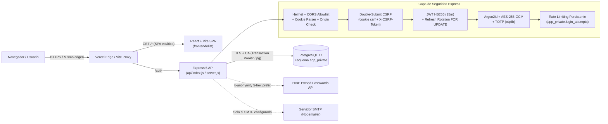

# Arquitectura — Security Lab

Security Lab es una aplicación full-stack de aprendizaje y verificación de seguridad web construida con **React + Vite** en el frontend, **Express 5** en el backend y **PostgreSQL 17** (local y Supabase) como base de datos relacional en un esquema privado (`app_private`).

## Principios arquitectónicos

1. **Mismo origen prioritario**:
   - En desarrollo local, Vite (`http://localhost:5173`) actúa como proxy de `/api/*` hacia Express (`http://127.0.0.1:3001`).
   - En producción (Vercel), un único dominio HTTPS sirve los estáticos de `frontend/dist` y enruta `/api/*` a la función serverless `api/index.js`.
2. **Separación de aplicación y servidor**:
   - `backend/src/app.js` construye la instancia Express (`createApp({ pool, env, mailer, hibpChecker })`) sin abrir puertos, lo que permite pruebas reales con `supertest` y despliegue serverless en `api/index.js`.
   - `backend/src/server.js` levanta el servidor HTTP en loopback (`127.0.0.1:3001`) para ejecución local.
3. **Esquema privado y mínimo privilegio**:
   - Todas las tablas residen en `app_private`, fuera de la exposición de Supabase Data API (`public`).
   - El rol `security_lab_runtime` solo posee permisos DML (`SELECT, INSERT, UPDATE, DELETE`) y no puede ejecutar DDL ni crear roles/bases.
4. **Tokens y estado en cliente**:
   - `accessToken` JWT (15 min) vive únicamente en memoria JS (`frontend/src/api/client.js`); nunca se guarda en `localStorage` ni `sessionStorage`.
   - `refresh` token opaco (7 días) viaja en cookie `HttpOnly`, `SameSite=Strict`, `Path=/api/auth` (`Secure` en producción).
   - El cliente coordina renovaciones concurrentes con un mutex single-flight (`refreshSessionSingleFlight`) para no disparar la detección de reutilización en el servidor.

## Diagrama de arquitectura

## Estructura de módulos

| Ruta | Responsabilidad |
|---|---|
| `api/index.js` | Adaptador serverless Vercel que reutiliza `pool` y `createApp()` |
| `backend/src/server.js` | Servidor local en `127.0.0.1` con apagado ordenado |
| `backend/src/app.js` | Configuración Express, Helmet, CORS, rutas y manejo de errores |
| `backend/src/config/env.js` | Validación estricta de variables de entorno con Zod |
| `backend/src/config/database.js` | Pool `pg` sin prepared statements nombrados y TLS con CA |
| `backend/src/security.js` | Argon2id, SHA-256, JWT, AES-256-GCM, TOTP, códigos de respaldo y RBAC |
| `backend/src/middleware/auth.js` | `requireAuth`, `requireCsrf`, `audit`, rotación de refresh tokens |
| `backend/src/services/hibp.js` | Lista local + consulta k-anonymity a HIBP con fallback documentado |
| `backend/src/services/mailer.js` | Transporte SMTP Nodemailer real (sin simulación si falta SMTP) |
| `backend/src/services/rateLimit.js` | Contadores persistentes por cuenta e IP en PostgreSQL |
| `backend/src/routes/*.js` | Endpoints modulares: `auth`, `mfa`, `notes`, `sessions`, `admin` |
| `frontend/src/api/client.js` | Cliente HTTP con CSRF automático, sanitización y refresh single-flight |
| `frontend/src/components/*.jsx` | Vistas públicas, privadas, MFA, sesiones, admin y laboratorio HTTP |
