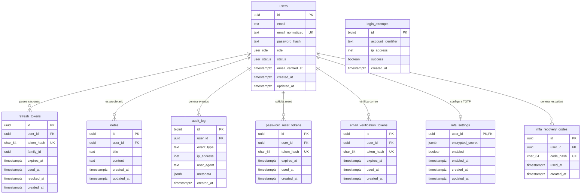

# Base de datos — PostgreSQL (`app_private`)

La fuente de verdad del esquema es la migración versionada [20261125153217_initial_security_schema.sql](file:///C:/Users/DELL1/.gemini/antigravity/scratch/seguridad-con-expres/supabase/migrations/20261125153217_initial_security_schema.sql).

## Seguridad del esquema y roles

- Todo el modelo vive en el esquema privado `app_private`, revocado explícitamente de `PUBLIC`, `anon` y `authenticated`.
- **Migrador (`security_lab_migrator`)**: propietario de las tablas en desarrollo/pruebas locales; sin `SUPERUSER`, `CREATEDB`, `CREATEROLE` ni `INHERIT`.
- **Runtime (`security_lab_runtime`)**: solo `USAGE` sobre `app_private` y `SELECT, INSERT, UPDATE, DELETE` sobre tablas/secuencias. No tiene privilegios DDL (`CREATE`, `ALTER`, `DROP`).
- **Supabase Data API**: `app_private` no se expone en `supabase/config.jsonc` (`schemas = ["public", "graphql_public"]`), por lo que PostgREST no publica endpoints para estas tablas.

## Diagrama Entidad-Relación

## Tablas e índices principales

| Tabla | Propósito | Restricciones e índices clave |
|---|---|---|
| `users` | Cuentas, rol (`user`/`admin`), estado (`active`/`disabled`/`pending_verification`) | `email_normalized` generado y único; longitud 3..254 |
| `refresh_tokens` | Familias de tokens opacos SHA-256 con rotación y revocación | `token_hash` único; `expires_at > created_at`; índices por `(user_id, family_id)` y `family_id` activo |
| `notes` | Notas privadas de cada usuario | `title <= 160`, `content` 1..5000; índice `(user_id, created_at desc)` |
| `audit_log` | Registro inmutable de eventos de seguridad | `ON DELETE SET NULL` en `user_id`; índices por `(user_id, created_at desc)` y `(event_type, created_at desc)` |
| `email_verification_tokens` | Tokens de activación (24h, uso único) | `token_hash` único; índice parcial `where used_at is null` |
| `password_reset_tokens` | Tokens de recuperación (1h, uso único) | `token_hash` único; índice parcial `where used_at is null` |
| `mfa_settings` | Secreto TOTP cifrado con AES-256-GCM en JSONB | Clave primaria `user_id` |
| `mfa_recovery_codes` | 8 códigos de respaldo hasheados con SHA-256 | `code_hash` único; índice parcial `where used_at is null` |
| `login_attempts` | Limitación de tasa persistente por identificador e IP | Índices `(account_identifier, created_at desc)` y `(ip_address, created_at desc)` |
