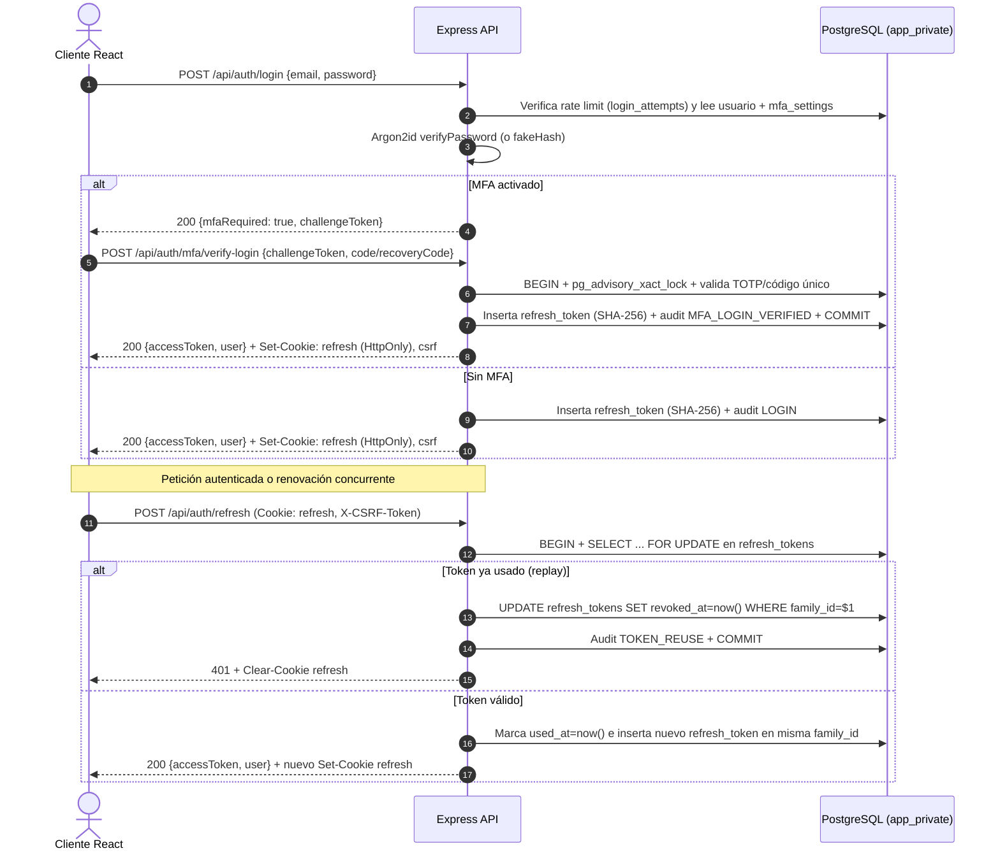
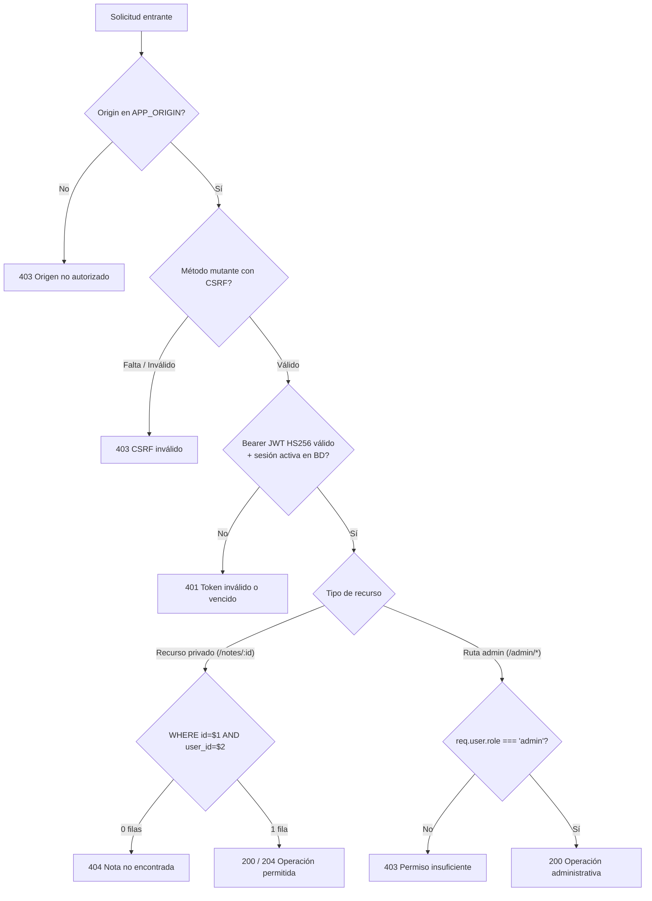

# Controles de Seguridad — Security Lab

## Resumen de controles implementados

| Control | Implementación | Archivo(s) |
|---|---|---|
| Hashing de contraseñas | **Argon2id** (`memoryCost: 19456` KiB / 19 MiB, `timeCost: 2`, `parallelism: 1`) | [security.js](file:///C:/Users/DELL1/.gemini/antigravity/scratch/seguridad-con-expres/backend/src/security.js) |
| Política de contraseñas | 15 a 128 caracteres sin truncamiento silencioso ni composición forzada; lista local + **HIBP k-anonymity** (envía solo primeros 5 hex SHA-1; fail-open documentado si red falla) | [hibp.js](file:///C:/Users/DELL1/.gemini/antigravity/scratch/seguridad-con-expres/backend/src/services/hibp.js) |
| Anti-enumeración en login | Verificación contra `fakeHash` Argon2id cuando el usuario no existe; respuesta genérica `401` y `202` | [auth.js](file:///C:/Users/DELL1/.gemini/antigravity/scratch/seguridad-con-expres/backend/src/routes/auth.js) |
| Access Tokens JWT | Algoritmo fijo `HS256`, `iss`, `aud`, `exp` (15m), `sub`, `sid`, `jti`, `typ='access'`; validación en BD de usuario activo y familia no revocada | [security.js](file:///C:/Users/DELL1/.gemini/antigravity/scratch/seguridad-con-expres/backend/src/security.js), [auth.js](file:///C:/Users/DELL1/.gemini/antigravity/scratch/seguridad-con-expres/backend/src/middleware/auth.js) |
| Refresh Tokens | 32 bytes aleatorios (`base64url`), digest SHA-256, cookie `HttpOnly`, `SameSite=Strict`, `Path=/api/auth`, `Secure` en producción | [auth.js](file:///C:/Users/DELL1/.gemini/antigravity/scratch/seguridad-con-expres/backend/src/middleware/auth.js) |
| Rotación y Reuse Detection | Transacción SQL con `SELECT ... FOR UPDATE`; si `used_at` ya existe, revoca toda la familia y audita `TOKEN_REUSE` | [auth.js](file:///C:/Users/DELL1/.gemini/antigravity/scratch/seguridad-con-expres/backend/src/routes/auth.js) |
| MFA TOTP + AES-256-GCM | Secreto TOTP generado con `otplib`, cifrado en servidor con **AES-256-GCM** e IV aleatorio de 12 bytes + tag de autenticación; 8 códigos de respaldo SHA-256 de un solo uso; desafío `mfa_challenge` de un solo uso (`pg_advisory_xact_lock`) | [mfa.js](file:///C:/Users/DELL1/.gemini/antigravity/scratch/seguridad-con-expres/backend/src/routes/mfa.js) |
| Reautenticación | Exige contraseña actual para cambiar contraseña, iniciar setup MFA, regenerar respaldos o desactivar MFA | [auth.js](file:///C:/Users/DELL1/.gemini/antigravity/scratch/seguridad-con-expres/backend/src/routes/auth.js), [mfa.js](file:///C:/Users/DELL1/.gemini/antigravity/scratch/seguridad-con-expres/backend/src/routes/mfa.js) |
| CSRF y Origin/CORS | Double-submit cookie (`csrf` + header `X-CSRF-Token` con `timingSafeEqual`) en mutaciones; allowlist estricta de `APP_ORIGIN` | [app.js](file:///C:/Users/DELL1/.gemini/antigravity/scratch/seguridad-con-expres/backend/src/app.js) |
| Rate Limiting persistente | Ventana deslizante de 15 min en `app_private.login_attempts` (compatible con serverless multi-instancia) + header `Retry-After` | [rateLimit.js](file:///C:/Users/DELL1/.gemini/antigravity/scratch/seguridad-con-expres/backend/src/services/rateLimit.js) |
| SQL Injection & Ownership | Consultas parametrizadas `$1..$n` en `pg`; cláusula `WHERE id=$1 AND user_id=$2` en lectura/edición/borrado de notas | [notes.js](file:///C:/Users/DELL1/.gemini/antigravity/scratch/seguridad-con-expres/backend/src/routes/notes.js) |
| RBAC y Auditoría | Middleware `requireRole('admin')` validado en servidor; `audit_log` sin credenciales ni tokens | [admin.js](file:///C:/Users/DELL1/.gemini/antigravity/scratch/seguridad-con-expres/backend/src/routes/admin.js) |

## Diagrama de autenticación, MFA y rotación de refresh tokens

## Diagrama de autorización (RBAC y Ownership)

## Comportamiento documentado ante fallos externos

- **HIBP Pwned Passwords (`hibp.js`)**: Si la API externa supera el timeout de 2500 ms o devuelve error HTTP/red, el sistema aplica **fail-open** registrando `HIBP_CHECK_UNAVAILABLE` en `audit_log` y manteniendo el bloqueo local de contraseñas comunes y longitud mínima de 15 caracteres.
- **SMTP (`mailer.js`)**: Si `SMTP_HOST`, `SMTP_PORT` y `SMTP_FROM` no están definidos, `mailer.configured` es `false` y la API responde honestamente `emailSent: false` indicando que se requiere SMTP real, sin simular entregas exitosas.
